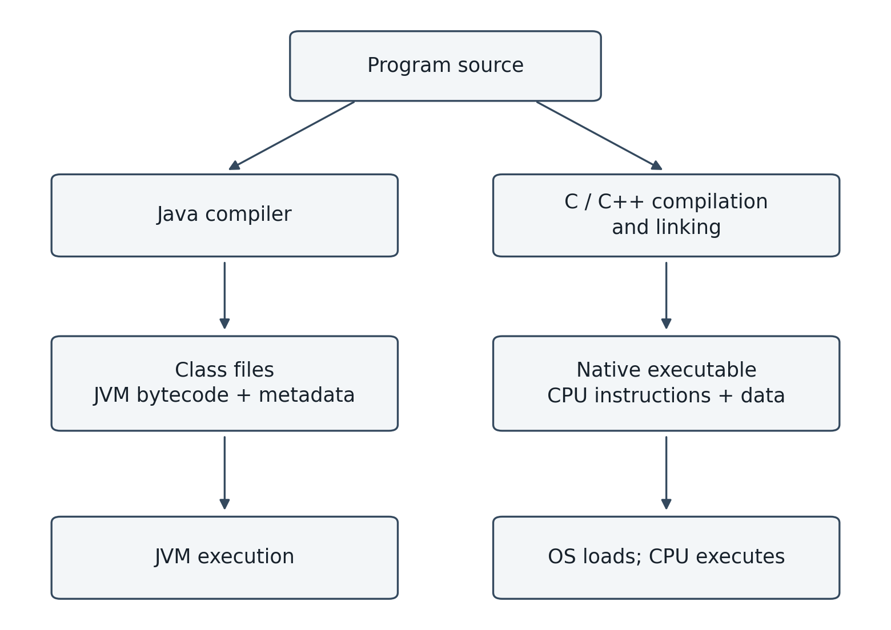
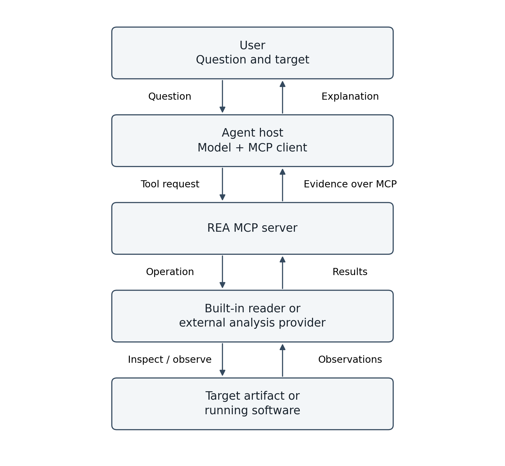
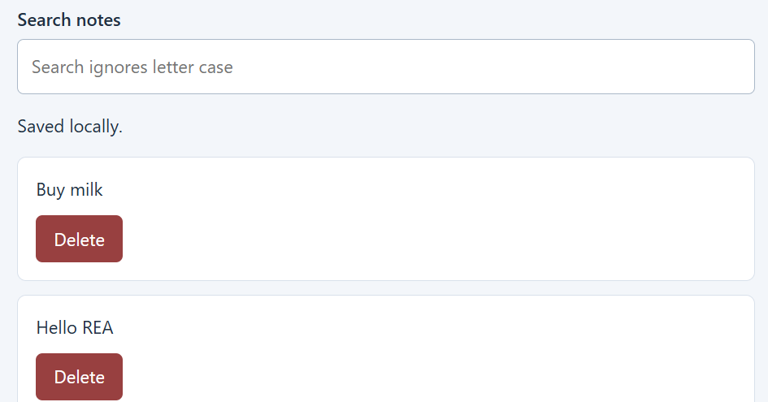
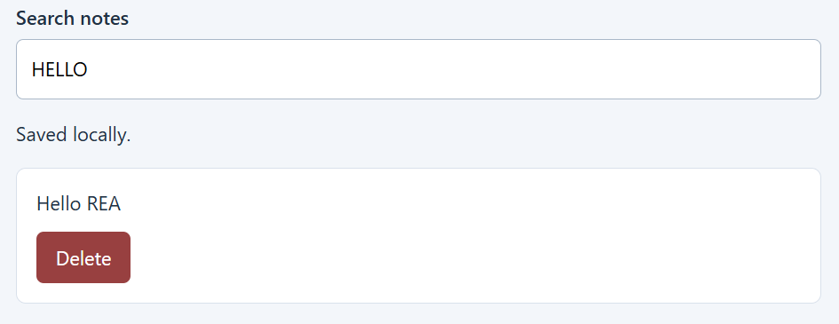

# Understanding REA: A Beginner’s Guide to AI-Assisted Reverse Engineering

**Harsh Suhagiya**  
Concordia University Wisconsin  
October 18, 2026  
Version 1.0 - Educational guide

This independent guide is for students who know basic programming but are new to reverse engineering. It is neither an official REA manual nor an original research paper. It explains the tools, documents one user-run demonstration, and identifies the limits of the available evidence. Technical statements reflect documentation consulted on October 18, 2026; the project changes over time.

The companion PDF uses APA 7 student-paper conventions for layout and citations (American Psychological Association, 2025). It is adapted for a standalone guide: no course, instructor, or assignment due date is asserted. Repository maintainers are identified by public account; undated, changing documentation includes retrieval dates.

AI assistance was used in planning, drafting, code generation, and formatting. Harsh Suhagiya supplied the manual checks, screenshots, and agent-generated reports. The editorial workflow reviewed those materials but did not independently inspect or execute the target. Examples marked illustrative are not experimental results. Original REA response payloads were not preserved; the case study discloses that limitation.

## Reading Map

1. From Source Code to Reverse Engineering
2. Introducing REA
3. How the Components Work Together
4. Choose the Right Target and Tools
5. Installation, Connection, and Verification
6. Investigating the Packaged Notes App
7. Capabilities, Limitations, and Common Misconceptions
8. Practical Uses, Privacy, and Responsible Handling
9. Glossary, Further Learning, and Research Directions


---

# From Source Code to Reverse Engineering

## Source Code: A Human-Readable Description

Source code expresses a program in a programming language. Names and comments help readers understand its intent. Consider this illustrative Java example:

```java
public class PriceCalculator {
    public static double finalPrice(double price) {
        // Apply a 10% discount at or above the $100 threshold.
        if (price >= 100) {
            return price * 0.90;
        }

        // Leave prices below the threshold unchanged.
        return price;
    }
}
```

Reading the code reveals a threshold of 100 and a discount multiplier of 0.90. This is a teaching example, not a production payment implementation: floating-point values can introduce rounding effects, and the function does not validate inputs.

## Compilation: Different Routes to Execution

Programs do not all reach execution in the same way. Java source is typically compiled into class files containing JVM bytecode and supporting information. The JVM executes that representation; an implementation may interpret instructions or compile them to native machine instructions (Oracle, 2025).

C and C++ commonly follow a native compilation route, with compilation and linking producing an executable for a particular target platform. Real build systems involve additional stages; Figure 1 is deliberately simplified.

**Figure 1**

*Two Common Routes From Source to Execution*



*Note.* Original explanatory diagram. Java bytecode and native CPU instructions are different representations. Build stages are simplified.

The word **binary** is often used for compiled artifacts. It does not mean every such file contains only native machine instructions: Java class files are binary files too.

## What Changes When Software Is Compiled?

A distributed application may include compiled code, scripts, resources, libraries, or a mixture of these. Receiving an application does not necessarily mean receiving its original source project.

Information available to an analyst varies. Java class files often retain class and method names; native binaries may retain symbols or ship with debugging information. Comments and some source-level details are usually unavailable, while optimization and obfuscation can make reconstruction harder. Do not assume that all readable information disappears—or that all original information survives.

## Reverse Engineering: Investigate the Finished Artifact

Reverse engineering investigates an existing system to understand its structure or behavior. An analyst may examine files without executing them (**static analysis**) or observe a running program (**dynamic analysis**).

For the price calculator, useful questions include:

- Where does the discount begin?
- Is the discount fixed or configurable?
- What happens with invalid inputs?

Reverse-engineering frameworks such as Ghidra provide facilities including disassembly and decompilation. These are parts of an investigation, rather than guarantees that its conclusions are correct (National Security Agency, n.d.).

## Decompilation Is a Reconstruction

A decompiler attempts to produce a higher-level representation of compiled code. A **disassembler**, by comparison, represents machine instructions as assembly language.

An illustrative reconstruction of our pricing logic might look like this:

```text
if value >= 100:
    return value * 0.9
return value
```

This pseudocode is hand-written for explanation; it is not output from REA or a decompiler. A real result might be incomplete or incorrect, and may not preserve the original names, comments, or structure.

Recovering plausible logic is different from recovering the exact source files. Reconstructing one function is also different from rebuilding an entire application.

## Evidence: Observations and Explanations

Table 1 shows expected results for the illustrative calculator; these are not measurements.

The following information is organized in Table 1.

**Table 1**

*Expected Values for an Illustrative Discount Rule*

| Input price | Output price | What it helps investigate |
| --- | --- | --- |
| 99 | 99 | Behavior below a possible threshold |
| 100 | 90 | Behavior at the possible threshold |
| 101 | 90.90 | Behavior just above it |

These are expected mathematical results for our example, rounded for presentation—not recorded execution results. Actual floating-point output and display formatting may differ.

The statement “input 100 returned 90” would be an **observation** if recorded from a run. The statement “all prices at or above 100 receive 10% off” is a broader **inference**. Several successful tests support that explanation but do not prove it for every possible input.

Good analysis states what was inspected, what was observed, what is inferred, and what remains untested. A mismatch should be investigated: the explanation, test, environment, or expected result could be wrong.

## Where REA Enters the Picture

REA connects an AI coding agent to software-analysis tools through MCP and also exposes terminal workflows. Its documented outputs include evidence and limitations. The agent can use those results to explain behavior or develop an implementation (Morluto, n.d.-g).

The distinction matters: the analysis tools produce findings; the agent interprets them; a person still needs to assess the conclusion. We will examine those roles in the next chapters. Java is used here to explain compilation, not to claim that REA supports every Java artifact.


---

# Introducing REA

## What Is REA?

**REA stands for Reverse Engineer Anything.** It provides a command-line interface (CLI) and a Model Context Protocol (MCP) server for software investigation. The CLI accepts terminal commands; the MCP server lets compatible AI agents request analysis operations (Morluto, n.d.-g; REA, n.d.-b).

An **AI coding agent** is an application that combines a language model with tools to carry out programming tasks. REA supplies investigation capabilities to that agent; it is not a separate language model (REA, n.d.-b).

## Who Is Behind the Project?

The official repository is **morluto/rea**. Its owner publicly uses the name **Morluto**, lists REA among their projects, and accepts community contributions through GitHub. This guide identifies the public account without asserting a legal name, nationality, or organizational affiliation (Morluto, n.d.-f, n.d.-g).

## What Problem Does It Address?

A model explaining unfamiliar software needs access to relevant evidence. Otherwise, a plausible answer can be difficult to distinguish from an informed guess.

REA connects the agent to analysis capabilities so it can inspect artifacts and follow relevant code. The agent can ask follow-up questions and use the results to explain behavior or help construct an implementation. Local terminal workflows are also available (REA, n.d.-b).

For a beginner, the useful question is not “Can it reverse everything?” but “What can this setup establish about this particular target?”

## Who Does What?

The following information is organized in Table 2.

**Table 2**

*Roles in an Agent-Assisted Investigation*

| Component | Role |
| --- | --- |
| User | Chooses the target, question, permissions, and acceptance criteria |
| AI coding agent | Plans an investigation and interprets tool results |
| MCP | Carries structured tool requests and results between a client and server |
| REA | Exposes and coordinates supported investigation operations |
| Analysis provider | Performs specialized inspection; native analysis can use Ghidra, Hopper, or IDA |

REA setup also installs workflow instructions for supported agents. Having instructions available does not mean every task will succeed (Morluto, n.d.-g).

A **decompiler** transforms compiled code into a higher-level representation. REA has a broader coordination role: it exposes analysis workflows, including integrations with existing decompilers. The agent’s explanation remains a conclusion to assess, not a correctness certificate (Morluto, n.d.-g; REA, n.d.-b).

## A Concrete Question

Consider this illustrative request about a small Notes application we own:

> Identify how search matches notes. Show the relevant implementation and explain whether matching is case-sensitive.

A useful answer should identify the matching operation, link it to relevant code, and disclose uncertainty. If runtime access is available and authorized, selected input/output checks can add evidence. This is a reporting standard, not a guaranteed output format.

Different artifacts support different investigations. JavaScript packages may expose readable code; native executables usually require different tools. The case study documents the selected target and its prerequisites (REA, n.d.-b).

## Cost, Locality, and Scope

REA-authored code uses the MIT license; external components retain their own terms. An AI service or commercial analysis provider may introduce separate costs (Morluto, n.d.-g).

The project states that analysis runs locally. Tool results still reach the agent, whose model provider has its own data policy. Local analysis therefore does not, by itself, establish that every part of the workflow stays on the computer (REA, n.d.-b).

This guide uses software we own or are authorized to examine, consistent with the project’s stated scope (Morluto, n.d.-g).


---

# How the Components Work Together

## The Host, Client, and Server

The coding application is the **MCP host**. Inside it, an MCP client maintains a connection to a server such as REA. A language model helps the host decide which operation to request, while the application actually sends the tool call. These distinctions explain why “the AI calls REA” is convenient shorthand (Model Context Protocol, n.d.).

MCP standardizes communication; it does not perform decompilation, supply intelligence, or certify the truth of results. The REA server exposes supported analysis operations. Some use built-in readers; others use external providers (Model Context Protocol, n.d.; Morluto, n.d.-g).

## The Investigation Loop

Figure 2 shows how requests and findings move among the components.

**Figure 2**

*The REA Investigation Loop*



*Note.* Original conceptual diagram. MCP links the host client to REA. Provider connections need not use MCP; static inspection does not require launching the target.

A terminal command can enter the analysis workflow without an MCP host. In that case, the person or script issuing the command interprets its output (Morluto, n.d.-g).

## Start with a Narrow Question

For the Notes demonstration, a focused request is:

> Inspect this packaged app. Does search ignore letter case? Identify the matching logic and show the evidence.

Before inspection, identify the exact target and its version. A path to a different build could produce a correct analysis of the wrong program. Agree on the investigation’s scope, particularly whether execution or interaction is permitted.

## Inspect, Follow Evidence, and Refine

The agent may first establish the artifact’s type and locate relevant modules. It can then follow references or inspect a selected function. A result may lead to another request instead of an immediate answer. This question–inspection–follow-up cycle is the documented REA workflow (Morluto, n.d.-g; REA, n.d.-b).

For example, finding a variable named `search` is a clue, not proof of how the displayed results are selected. The investigation must connect the relevant handler to its matching operation and, if necessary, its callers.

## Example: What Would Support a Conclusion?

Imagine the inspected app contains the following code:

```javascript
function matches(note, query) {
    // Normalize both strings before checking for a substring.
    return note.toLowerCase().includes(query.toLowerCase());
}
```

This is an invented teaching snippet, not recovered REA output. It suggests lowercase normalization before substring matching. A careful explanation would identify the actual file and function, then establish that the app’s search feature uses it.

The following information is organized in Table 3.

**Table 3**

*Evidence and Its Interpretive Boundaries*

| Evidence | What it supports | What it does not establish alone |
| --- | --- | --- |
| Matching function’s code | How that function transforms and compares strings | That the user interface calls this function |
| References from a search handler | A connection between the handler and function | That every configuration uses the same path |
| A recorded search for `HELLO` finding `Hello` | Case-insensitive behavior for that example | Correct matching for every language and character |

Lowercase conversion is not a complete specification of international text matching. That limitation should remain visible rather than being hidden behind “search always ignores case.”

## Return an Answer That Can Be Checked

For this guide, we will ask an investigation report to contain:

1. **Target:** the artifact, version, and relevant environment.
2. **Conclusion:** a direct answer scoped to what was inspected.
3. **Evidence:** source locations, instructions, references, or recorded observations.
4. **Limitations:** missing context and untested cases.
5. **Verification:** checks performed and checks still needed.

This is our reporting convention, not a claim that REA automatically returns every field in this layout. Available evidence depends on the operation and provider (Morluto, n.d.-g).

## Static Findings and Runtime Effects

Reading a packaged script can provide evidence without launching the application. Observing a live feature may require running or interacting with it. The README distinguishes static inspection from runtime capture, which uses the current user’s permissions (Morluto, n.d.-g).

The requests and snippets in this section are illustrative. The case study later in the guide identifies the supplied reports and observed checks.


---

# Choose the Right Target and Tools

## Support Depends on the Operation

A target is the artifact or running system being examined. “Supported” must be read in context: a metadata reader, decompiler, and runtime observer answer different questions. Recognizing a file format does not establish that every feature inside it can be reconstructed.

The following is a selective map of documented capabilities, not an exhaustive compatibility list. These are documentation-based descriptions, not tests performed for this guide (Morluto, n.d.-g).

The following information is organized in Table 4.

**Table 4**

*Selected REA Targets and Prerequisites*

| Target | Typical findings | Additional prerequisites |
| --- | --- | --- |
| Native executable | Instructions, pseudocode, references | Ghidra, Hopper, or IDA; provider-specific host support |
| JavaScript / Electron | Modules and feature relationships | Node.js/npm; Linux also needs compatible `ps` |
| Website | Browser-visible scripts and observations | Chrome-family browser and configured connection |
| .NET assembly | Metadata and CIL instructions | Built-in static analysis |
| Android APK | Manifest, classes, reconstructed methods | Headless JADX and full JDK |
| Android device | Packages and logs | Configured adb |
| Firmware | Embedded regions and extracted content | Linux tools such as Binwalk or Unblob |
| Packet capture | Protocol fields and traffic summaries | TShark; requirements vary by operation |
| SQLite snapshot | Schema and selected rows | Compatible Node.js SQLite support |

The base README specifies Node.js 22.x >=22.19, 24.x >=24.11, or 26+, plus npm. Individual workflows can impose stricter requirements. Main-branch documentation may describe features newer than the installed package (Morluto, n.d.-g).

## Why JavaScript/Electron Is Our Starting Point

An Electron application combines web technologies with desktop capabilities. Understanding a feature may require following relationships between its renderer, preload layer, and main process. The application graph workflows help investigate these connections and retain coverage limitations (Morluto, n.d.-c).

Our Notes app is a suitable teaching target because we control its implementation and can compare findings against known source. Its packaged JavaScript may remain readable. This demonstration illustrates application investigation; it does not evaluate native machine-code recovery.

Static relationships are not automatically proof of runtime execution. The JavaScript workflow documentation explicitly distinguishes artifact observations, runtime observations, and relationship inferences (Morluto, n.d.-c).

## Websites Reveal What the Browser Can Access

Browser investigation can reveal frontend code, page behavior, and observable requests. The browser workflow requires a configured connection; supplying a public URL alone is not a substitute for that setup (Morluto, n.d.-b).

A request to a remote search service may show the endpoint, submitted query, and returned response. It does not, by itself, reveal the server’s private implementation. The explanation should stop at that evidence boundary.

## An APK Is Not the Same as a Java Class File

Java knowledge helps with some Android concepts, but the artifacts differ. An Android application package can contain DEX bytecode, resources, and native libraries. JADX-based analysis addresses managed-code portions; native libraries need a suitable separate workflow (Morluto, n.d.-a).

Do not infer general Java/JAR support merely from Android support. For any proposed input, check the documented operation and installed version.

## Choose Using the Question

Before adding tools, write one sentence describing the information needed. Then choose an operation that can supply evidence for it.

The following information is organized in Table 5.

**Table 5**

*Questions and Relevant Evidence*

| Question | Evidence to seek |
| --- | --- |
| Does Notes normalize search text? | Matching code and a link to the search handler |
| Which module writes a note to disk? | Write operation, callers, and relevant paths |
| Which request follows clicking Search? | Recorded browser interaction and network observations |
| What changed between releases? | Comparable artifacts, version identities, and scoped differences |

These are investigation plans, not promises that an operation will resolve every question. Missing dependencies, dynamic code, or incomplete coverage can leave an answer unknown.


---

# Installation, Connection, and Verification

**Status:** Documentation-based setup instructions. These command blocks are not execution transcripts. the case study separately records the user-run Windows setup and demonstration, including versions and limitations.

## Prepare the Environment

Use a terminal on the computer where the target files will be available: PowerShell on Windows or an appropriate shell on macOS/Linux. Check the runtime:

```sh
node --version
npm --version
```

Compare the reported Node.js version with the target overview and the current official setup guide. If a command is unavailable, install a supported Node.js release from https://nodejs.org/ and reopen the terminal. An existing Java installation does not supply Node.js.

On Windows PowerShell, use `npm.cmd` and `npx.cmd` if PowerShell blocks the corresponding `.ps1` launcher. For example, use `npm.cmd --version` and `npx.cmd rea-agents@latest setup`. This is the launcher route used in our demonstration; no execution-policy change was needed.

Choose one compatible coding agent. CLI-only use is also possible; it does not establish an agent connection (REA, n.d.-a).

## Run Guided Setup

```sh
npx rea-agents@latest setup
```

Select the intended agent, inspect the proposed changes, approve the desired plan, and restart the named application. Setup registers the MCP server and matching workflow instructions. Optional native-provider setup is separate; it is unnecessary for our initial static JavaScript example (Morluto, n.d.-e; REA, n.d.-a).

Do not confuse downloading an npm package with approving REA’s configuration changes. They are separate steps (Morluto, n.d.-e).

## Check the Registration

For a Codex registration, the documented scoped diagnostic is:

```sh
npx rea-agents@latest doctor --client codex --json
```

For another client, use its documented identifier. A registration check examines configuration, not the active agent connection. After restarting, confirm that the agent exposes REA tools (Morluto, n.d.-e).

The distinction is practical: a correctly saved configuration can coexist with a session that has not reloaded it. Record the agent’s actual tool listing or connection status rather than infer a live connection from setup alone.

## Try One Static Analysis

After creating our demonstration target, replace the placeholder with its actual extracted application directory or ASAR archive:

```sh
npx rea-agents@latest analyze-javascript-application "/absolute/path/to/app" --json
```

On Windows, a quoted path such as `"C:/rea-demo/app"` can identify the target. Static JavaScript analysis does not require launching the application. On Linux, check the documented `ps` prerequisite (Morluto, n.d.-g).

Inspect the result’s target identity, available findings, and limitations. An empty result is not automatically evidence that a feature does not exist. Confirm that the intended artifact and relevant files were examined.

## Record What Actually Happened

For the worked example, fill in this record from observed output:

The following information is organized in Table 6.

**Table 6**

*Information to Record for a Run*

| Field | What to record |
| --- | --- |
| Environment | OS, architecture, Node.js, and npm versions |
| Agent | Application and version, or CLI-only |
| REA | Actual package/server version used |
| Target | Filename, version, and preferably a content digest |
| Action | Exact command or prompt |
| Outcome | Findings, warnings, errors, and saved evidence |

A digest is a content-derived identifier that helps distinguish artifacts. Do not publish credentials or private target data with the record.

Using `@latest` is convenient for initial setup but changes over time. For a reproducible demonstration, record and reuse the exact version; do not invent one in advance (Morluto, n.d.-e).

## Diagnose the Failed Layer

The following information is organized in Table 7.

**Table 7**

*Troubleshooting by Layer*

| Symptom | First question |
| --- | --- |
| `node` is unavailable | Is Node.js installed and visible to this terminal? |
| Agent has no REA tools | Was the intended client selected and restarted? |
| Native analysis fails | Is its required provider configured? |
| Target cannot be read | Does the path identify the intended accessible artifact? |
| Documented feature is absent | Does this installed release include it? |

Treat these as starting questions, not automatic diagnoses. Preserve the exact error before making changes, then consult the relevant official guide.


---

# Investigating the Packaged Notes App

**Evidence status:** This chapter summarizes the investigation transcript supplied by Harsh Suhagiya on October 18, 2026, plus his reported manual checks. The guide editor has read the transcript but has not received the archive, inspected the original implementation, or independently executed this analysis. Initial claims below are attributed to the REA report; the direct-verification subsection records a separate user-supplied direct-verification report (Suhagiya, 2026a; Suhagiya, 2026b).

## What We Built and Tested

The demonstration uses an AI-assisted Electron Notes app. Before packaging, Harsh Suhagiya reported that four checks passed: adding notes, finding `Hello REA` using both `hello` and `HELLO`, retaining notes after a restart, and retaining deletion after another restart.

Those observations concern selected cases in the development launch. They do not prove every input works or that the packaged artifact behaves identically. Packaging completed without a reported error using `npm.cmd run package:asar`; its script stages files and packs `build/app` into `dist/app.asar`.

ASAR is an application archive. This example investigates packaged JavaScript, not encrypted source or native machine-code decompilation.

## Screenshots of the Manual Search Check

Figures 3 and 4 show the unfiltered notes and one search check, respectively.

**Figure 3**

*Notes Before Filtering*



*Note.* Detail cropped from a screenshot supplied by Harsh Suhagiya; original image: assets/notes-unfiltered.png. Both notes are visible with an empty query. The displayed “Saved locally” message does not independently establish durable storage.

**Figure 4**

*Uppercase Query With a Mixed-Case Match*



*Note.* Detail cropped from a screenshot supplied by Harsh Suhagiya; original image: assets/search-hello.png. HELLO matches Hello REA in one selected check. This does not prove behavior for every input, restart persistence, or the running build’s identity.

## Investigation Scope

The analysis prompt restricted the agent to the supplied `app.asar`, requested static analysis, and prohibited execution, modification, and reading the original source directories or README. REA’s own workflow instructions were permitted. A fresh conversation was requested to reduce reliance on the earlier app-building discussion; this is not an enforced isolation boundary or a controlled benchmark.

The supplied activity log shows REA calls for application analysis, retained-evidence inspection, evidence-bundle retrieval, session identity, and a deletion-channel trace. It also shows reads of REA instructions. The agent reports respecting the artifact-only scope; the abbreviated transcript is not a complete filesystem-access audit.

## Findings, in Plain English

The following information is organized in Table 8.

**Table 8**

*Initial Findings and Their Limits*

| Question | What the agent reported | Important boundary |
| --- | --- | --- |
| How does search work? | Lowercase both the query and note text, then use substring matching | Reconstructed from static observations; not an execution trace |
| How are notes loaded? | Read a file, parse JSON, validate records, and populate memory; list requests return that collection | Exact storage path and full validation conditions unresolved |
| How are notes saved? | Serialize the new collection, write a temporary file, rename it, then update memory | Does not establish crash durability |
| How does deletion persist? | A renderer request crosses the preload bridge to a main-process handler that filters notes and calls `save` | Exact filter comparison unresolved; focused trace had no traversed edges |

The search reconstruction was:

```javascript
// Reconstructed expression reported by the analysis agent;
// not a direct source quotation independently checked by the editor.
const query = search.value.toLowerCase();
const visible = notes.filter(
    note => note.text.toLowerCase().includes(query)
);
```

The report places the relevant observations in archive member `renderer.js`, lines 14–15. The expression suggests an empty query matches every string and that this step does not trim the query. Broader behavior still depends on surrounding code and the actual values reaching the function.

## Deletion: An Explanation Assembled from Several Observations

The report links a deletion listener in `renderer.js` to `window.notesAPI.delete(note.id)`, then to the literal `notes:delete` channel in `preload.js`. A registered handler in `main.js` calls `save(notes.filter(...))`; the reported save routine serializes and writes the collection.

However, the focused REA feature trace found two matching channel nodes and **zero traversed edges**. Therefore, that trace alone does not demonstrate the full path. The agent assembled the explanation from other IPC, call, and argument observations. The exact removal comparison was unresolved at this initial stage.

That distinction is central to this example: missing graph edges limit one analysis result; they do not automatically mean the feature is absent or that another explanation is proven.

## Reproducibility Record

The following information is organized in Table 9.

**Table 9**

*Reported Demonstration Environment*

| Field | Value reported in the supplied material |
| --- | --- |
| Host | Windows x64 |
| Node.js / npm | 24.14.1 / 11.10.0 |
| Installed standalone Codex CLI | 0.163.0; exact client identity for this investigation not independently checked |
| REA server/package | 6.7.0 |
| Analysis provider | `rea-javascript-application`, version 1 |
| Target | `app.asar` from the Notes demonstration |
| Parsed JavaScript files / parse failures | 3 / 0 |
| Application / semantic coverage | Partial / unknown |
| Semantic unknowns | 272; not an error count or accuracy percentage |
| UI-reported analysis duration | 2 minutes 6 seconds; not a measured performance benchmark |

Reported artifact SHA-256:

```text
16ca3365959cbf4b89d858abe52a473e5c1e91f415e64cc0c9cc4dc8ecc4f492
```

Reported parent analysis evidence identifier:

```text
 ev_918c0d5bbb1ea907050e60174d54540b3140ca76ca73b04ccdd6f571474b024b
```

Reported deletion-trace evidence identifier:

```text
 ev_6ff2326ea28c145a646081a5c2f9bd164c91e1f68718756902292f13a0c6ae85
```

Evidence identifiers help associate records within a workflow; without exported evidence and the matching artifact, they do not let a reader reproduce this investigation.

## Direct Verification: A Separate Phase

After the initial investigation was preserved, the agent was allowed to read archive members directly and compare them with staged and original files. Harsh Suhagiya supplied the resulting verification report at 5:46 PM America/Chicago on October 18, 2026. The report states that the installed ASAR reader was used, no files were modified, and the app was not executed. The editor has reviewed this report, not the underlying files (Suhagiya, 2026a).

The following information is organized in Table 10.

**Table 10**

*Later Direct-Verification Findings*

| Item | Verification report | Relationship to the initial analysis |
| --- | --- | --- |
| Search | `renderer.js:14–15` contains the previously reconstructed expression | Confirms the reported syntax |
| Storage construction | `main.js:85` uses `path.join(app.getPath('userData'), 'notes.json')` | Resolves the argument and filename gaps |
| Deletion comparison | `main.js:56` uses `save(notes.filter(note => note.id !== id))` | Resolves the comparison-operator gap |
| Artifact contents | Six members match staged and original files byte-for-byte | Reports that the inspected artifact represents those files |
| Artifact identity | Recalculated SHA-256 equals the earlier digest | Reports consistency with the analyzed archive |

The six reported members are `index.html`, `main.js`, `package.json`, `preload.js`, `renderer.js`, and `styles.css`. The verification report also states that the archive and staging file inventories match.

The confirmed source expressions are:

```javascript
// Storage location construction, as quoted in the verification report.
notesFile = path.join(app.getPath('userData'), 'notes.json');

// Deletion keeps entries whose IDs differ from the requested ID.
return save(notes.filter(note => note.id !== id));
```

The storage expression identifies an application-specific user-data directory, not a complete fixed Windows pathname. No actual resolved pathname was supplied. The deletion predicate describes which entries are retained; whether an ID exists and whether a write succeeds are separate questions.

The verification report records no contradiction with the initial findings. Details resolved through direct source inspection remain attributed to that later phase, not to REA’s initial analysis.

## Runtime Evidence and Remaining Work

The verification report says runtime persistence was untested in that phase. Harsh Suhagiya had already reported successful manual restart and deletion checks before packaging. These statements refer to different phases: the manual checks provide selected development-run observations; direct verification was static. Neither demonstrates crash durability or establishes packaged-runtime behavior.

The original reports and two screenshots are included as supporting materials. Exact verification commands, raw REA responses, and the target archive were not supplied for this edition. The preservation limits are described next. Dependency-audit findings would need review before distributing the app itself; this guide package contains no executable application.

## Preserved Reports and Missing Raw Output

The following user-supplied reports are included unchanged in this package:

- [Initial REA investigation](evidence/rea-investigation.md): preserves findings, original uncertainties, evidence identifiers, and recovered tool-call metadata.
- [Later direct verification](evidence/direct-verification.md): describes the inspection method, six member sizes and hashes, byte comparisons, and resolved expressions.

The verification report describes using PowerShell `Get-FileHash`, Node hashing, and an installed ASAR reader to inspect bytes in memory. It reports using `Buffer.equals` for file comparisons. These are reported methods, not commands rerun by the guide editor.

Both reports are summaries preserved from the completed conversation. They are **not raw tool-response archives**. The original full REA response payloads and retained evidence bundle could not be recovered. Continued accessibility of the evidence IDs was not checked. No missing output has been invented. The source files, packaged app, exact verification script, and machine-readable comparison results are not included in this guide package.

A future experiment should retain complete requests, responses, targets, and verification scripts during execution. A new run would be separate evidence, not recovery of the missing output.


---

# Capabilities, Limitations, and Common Misconceptions

## What the Tool Can Contribute

REA supplies terminal and agent-accessible investigation workflows. Depending on the target and configured tools, results may include native instructions or pseudocode, application relationships, metadata, and runtime observations. The coding agent uses those findings to answer questions or help develop code. The README describes both the available evidence and target-dependent prerequisites (Morluto, n.d.-g).

Our Notes demonstration exercised a small portion of that scope: static analysis of packaged JavaScript and interpretation of retained findings. It did not evaluate native decompilation, firmware, Android, or malware analysis.

## Keep Claims Proportional to Evidence

The following information is organized in Table 11.

**Table 11**

*Common Misconceptions and Bounded Claims*

| Misconception | More defensible statement |
| --- | --- |
| “REA restores any application’s original source.” | Results depend on artifact and provider; native outputs include reconstructed representations, not guaranteed original source files (Morluto, n.d.-g). |
| “A supported format means every feature is understood.” | Availability, coverage, and uncertainty must be checked for the operation and target (Morluto, n.d.-c, n.d.-g). |
| “No parse failures means the explanation is correct.” | Parsing success does not validate the agent’s interpretation or establish complete behavior. |
| “An empty trace proves the feature is absent.” | The trace may lack relevant relationships or have incomplete coverage (Morluto, n.d.-c). |
| “We confirmed this example, so REA is accurate in general.” | One small demonstration supplies no representative accuracy estimate. |
| “Every tool in the catalog is ready on this machine.” | Some operations require providers, host support, or an opened target (Morluto, n.d.-g). |

Our deletion example makes the distinction concrete: the focused channel trace had zero traversed edges, while separate observations supported a candidate explanation. Later direct inspection confirmed the deletion comparison. These phases should remain distinct in reporting.

## Coverage Is Not Correctness

Coverage concerns what an analysis examined or represented. Correctness concerns whether a particular conclusion holds. REA’s JavaScript documentation retains partial coverage and unresolved relationships, including cases where an exhausted result page does not establish absence (Morluto, n.d.-c).

The reported **272 semantic unknowns** are not a measured bug count or a percentage of incorrect conclusions. Their interpretation requires the analyzer’s definitions and corresponding evidence. Similarly, the three parsed files and zero parse failures do not establish that every behavior was modeled.

## Reading Code and Observing Execution Answer Different Questions

Static inspection can reveal that the save function requests a write followed by a rename. It cannot alone establish that the filesystem accepted the write during a particular run. Manual restart tests add selected observations, but do not establish crash durability.

Readable reconstructed code also needs validation before reuse. A name such as `save` describes an apparent purpose; the actual operations, callers, error handling, and observed behavior determine what can be claimed.

## What This Case Study Cannot Establish

There was no comparison group, representative dataset, blinded assessment, or enforced source-access isolation. The underlying JavaScript was packaged but not deliberately hidden. The editor has reviewed supplied reports and screenshots, not independently inspected the target. Raw REA responses were not preserved.

Consequently, this guide cannot claim that REA outperforms direct code reading, another integration, or an experienced analyst. It also cannot attribute elapsed time to REA alone: model behavior, prompts, permissions, setup, and target size affect the overall workflow.

## A Useful Standard for Future Investigations

For each conclusion, identify the exact target, the supporting artifact or observation, the untested assumptions, and a check that could reveal an error. Save evidence while it is available. If a detail remains unresolved, leave it unresolved or collect additional evidence; do not silently fill it in.

The result should help another person distinguish “the tool returned this,” “the agent inferred this,” and “we checked this.”


---

# Practical Uses, Privacy, and Responsible Handling

## Begin with a Concrete Engineering Task

The following are proposed uses, not additional experiments performed for this guide. Choose software and data you are permitted to examine, then define the evidence needed for the task.

The following information is organized in Table 12.

**Table 12**

*Possible Engineering Tasks*

| Task | A focused investigation | A useful deliverable |
| --- | --- | --- |
| Learn application architecture | Follow one user action across components | A diagram linked to relevant functions |
| Document a legacy tool | Identify one input format and output transformation | A bounded format description with examples |
| Investigate a regression | Compare a selected feature in two identified builds | A change report with supporting observations |
| Prepare interoperability work | Study an authorized interface or file exchange | A small compatibility test suite |
| Improve software understanding | Compare the agent’s explanation with known implementation | A claim-by-claim verification report |

For our first project, explaining one search feature was more manageable than asking for the entire application to be rebuilt. A narrowly scoped answer can expose missing evidence before the investigation expands.

## Follow the Data Through the Whole Workflow

REA states that target analysis runs locally; its results reach the coding agent, whose model provider has its own data policy (REA, n.d.-b). Therefore, assess the complete path rather than equate local inspection with an entirely offline workflow.

The following information is organized in Table 13.

**Table 13**

*Data Across the Investigation Workflow*

| Stage | Material that may be involved | Practical decision |
| --- | --- | --- |
| Target selection | Files, scripts, logs, or recordings | Choose only what the question needs |
| Tool output | Code excerpts, metadata, strings, paths | Check whether findings contain confidential information |
| Agent processing | Prompt and tool results | Check the provider and organization’s applicable data rules |
| Publication | Screenshots, reports, exported evidence | Review what readers will receive |

The Notes demonstration uses ordinary example text. An investigation of workplace software or real user logs would require a separate assessment of access and disclosure permissions.

## REA Is Not a Sandbox

The project’s security policy states that REA does not sandbox the selected analysis provider. Even opening an untrusted artifact delegates parsing to local software with the current user’s permissions. Its bridge controls and temporary projects do not establish isolation from hostile inputs (Morluto, n.d.-h).

For a first learning exercise, use a small program you created. If unfamiliar or potentially malicious software must be examined, use an appropriately isolated environment and relevant expertise. Do not mistake “static” for a guarantee that every parser involved is harmless.

Runtime observation is a further choice: launching software may write files, make requests, or interact with existing data. State what operations are permitted before authorizing them. Our initial REA investigation requested static inspection only.

## Treat Inspected Content as Data

An application may contain text resembling instructions to an agent. Such text is evidence about the target, not authority to change the investigation’s goal. As an investigation practice, keep the user’s requested scope distinct from strings found in the artifact. Review unexpected requests for execution, configuration changes, or access to unrelated files.

This is general guidance for tool-using agents, not a claim that our Notes example contained an instruction attack or that a particular REA defense was tested.

## Permissions, Licenses, and Publication

The project positions REA for authorized research, education, interoperability, and preservation. Its responsible-use document does not grant rights to examine or redistribute someone else’s software (Morluto, n.d.-d).

For this guide, we use our own demonstration app. Before adding third-party code, screenshots, artifacts, or commercial-tool output, check the applicable permissions and terms. REA’s own license does not replace those terms (Morluto, n.d.-g).

When preparing a public report, remove secrets and unnecessary private data. If an investigation reveals a vulnerability in REA, the project requests private reporting through GitHub’s security workflow rather than disclosure of sensitive material in public issues (Morluto, n.d.-h).


---

# Glossary, Further Learning, and Research Directions

## Essential Terms

The following information is organized in Table 14.

**Table 14**

*Glossary of Essential Terms*

| Term | Meaning in this guide |
| --- | --- |
| Artifact | A file or packaged output selected for inspection |
| ASAR | An archive format used to package Electron application files |
| Bytecode | Instructions for a virtual machine, such as the JVM |
| Native machine code | Instructions for a specific CPU architecture |
| Disassembly | A representation of machine instructions as assembly language |
| Decompilation | Reconstruction of a higher-level representation from compiled code |
| Static analysis | Examination without executing the target application |
| Dynamic analysis | Observation of software while it runs |
| Coding agent | An application combining a model with tools for programming tasks |
| MCP | Model Context Protocol: a standard for client–server communication involving tools and other capabilities |
| Provider | A reader, engine, or integration supplying a particular analysis capability |
| IPC | Inter-process communication; Electron uses it across process boundaries |
| Evidence | Recorded material supporting a claim, with its source and limits |
| Provenance | The origin and history of a finding or artifact |
| Coverage | The portion of a target or relationships examined or represented |
| Ground truth | A reference used to assess a result; its correctness and relevance also need justification |
| SHA-256 digest | A content-derived identifier useful for checking artifact identity; not proof that the content is safe |
| Baseline | A reference method against which another method is compared |
| Counterexample | A case that contradicts a general claim |
| Reproducibility record | Artifacts, environment details, procedures, and outputs that let others attempt the same investigation |

## A Practical Learning Sequence

1. **Explain the architecture.** Describe the separate roles of the host, model, MCP client, REA server, and analysis provider using Figure 2.
2. **Repeat one small investigation.** Choose an authorized artifact and one question. Capture requests and raw results during the run.
3. **Verify a claim.** Compare the explanation with relevant code or a controlled execution check. Record disagreements.
4. **Change one condition.** For example, alter search behavior in a new app version, package it, and investigate that new artifact. Record both versions and digests.
5. **Study research methods.** Read closely related work before proposing a new contribution.

These are learning exercises. Repeating them does not automatically create an original research contribution.

## Two Starting Papers

**DecompileBench** (Gao et al., Findings of ACL 2025) evaluates decompilation with attention to both functional behavior and analyst-facing quality. Read it to understand why readable output and correct output need separate evaluation. Its native-decompilation setting differs from our Electron example (Gao et al., 2025).

**Reveree: Diagnosing LLM Reverse-Engineering Agents** (Benkraouda et al., arXiv preprint, September 2026) studies agent trajectories and intermediate progress as well as completed challenges. Read it to consider where an investigation fails, rather than treating success as a single binary outcome. The cited source is a preprint; no peer-reviewed publication status is asserted here (Benkraouda et al., 2026).

For each paper, record the question, evaluation tasks, baseline methods, measurements, findings, and limitations. These two readings are starting points, not an exhaustive literature review.

## Questions Prompted by Our Demonstration

The following information is organized in Table 15.

**Table 15**

*Candidate Research Questions*

| Candidate question | What an experiment would need |
| --- | --- |
| Do evidence requirements reduce unsupported explanations? | Comparable tasks, a fixed model and budget, a baseline, and independently assessed claims |
| Can targeted tests resolve static-analysis uncertainty? | An explicit checking strategy and separate unseen evaluation cases |
| Does incomplete graph coverage predict incorrect conclusions? | Operational definitions of coverage and errors, plus diverse targets |
| Do beginners understand software better with these tools? | A suitable study design, learning measures, and institutional review where applicable |

These are **candidate questions, not verified research gaps**. Existing work may already answer them or substantially overlap. A faculty mentor and a wider literature review should help narrow the question and establish novelty.

## From Demonstration to Research

Our guide documents one small application, supplied reports, selected manual checks, and known preservation limits. A research study would require a precise question, justified dataset, fair comparisons, an analysis plan, and complete records. A new method is one possible contribution; a rigorous discovery about existing methods can also matter.

Begin with a pilot that tests feasibility. Decide success measures before inspecting the final results, and keep evaluation data separate from material used to develop the method. Report negative results and uncertainty. Do not convert tool counts, one successful case, or a polished demonstration into claims of general superiority.

# References

American Psychological Association. (2025). *Student paper setup guide*. https://apastyle.apa.org/instructional-aids/student-paper-setup-guide.pdf

Benkraouda, H., Cai, H., Celik, B., & Wang, G. (2026). *Reveree: Diagnosing LLM reverse-engineering agents* [Preprint]. arXiv. https://doi.org/10.48550/arXiv.2609.01185

Gao, Z., Cui, Y., Wang, H., Qin, S., Wang, Y., Bolun, Z., & Zhang, C. (2025). DecompileBench: A comprehensive benchmark for evaluating decompilers in real-world scenarios. In W. Che, J. Nabende, E. Shutova, & M. T. Pilehvar (Eds.), *Findings of the Association for Computational Linguistics: ACL 2025* (pp. 23250–23267). Association for Computational Linguistics. https://doi.org/10.18653/v1/2025.findings-acl.1194

Model Context Protocol. (n.d.). *Architecture overview*. Retrieved October 18, 2026, from https://modelcontextprotocol.io/docs/learn/architecture

Morluto. (n.d.-a). *Android analysis*. GitHub. Retrieved October 18, 2026, from https://github.com/morluto/rea/blob/main/docs/android-analysis.md

Morluto. (n.d.-b). *Browser observation*. GitHub. Retrieved October 18, 2026, from https://github.com/morluto/rea/blob/main/docs/browser-observation.md

Morluto. (n.d.-c). *Cross-layer JavaScript application workflows*. GitHub. Retrieved October 18, 2026, from https://github.com/morluto/rea/blob/main/docs/javascript-application-workflows.md

Morluto. (n.d.-d). *Disclaimer*. GitHub. Retrieved October 18, 2026, from https://github.com/morluto/rea/blob/main/DISCLAIMER.md

Morluto. (n.d.-e). *Installation and setup*. GitHub. Retrieved October 18, 2026, from https://github.com/morluto/rea/blob/main/docs/installation.md

Morluto. (n.d.-f). *morluto* [GitHub profile]. GitHub. Retrieved October 18, 2026, from https://github.com/morluto

Morluto. (n.d.-g). *REA: Reverse engineer anything* [Computer software]. GitHub. Retrieved October 18, 2026, from https://github.com/morluto/rea

Morluto. (n.d.-h). *Security policy*. GitHub. Retrieved October 18, 2026, from https://github.com/morluto/rea/blob/main/SECURITY.md

National Security Agency. (n.d.). *Ghidra* [Computer software]. GitHub. Retrieved October 18, 2026, from https://github.com/NationalSecurityAgency/ghidra

Oracle. (2025). *The Java Virtual Machine specification: Java SE 25 edition, chapter 1*. https://docs.oracle.com/javase/specs/jvms/se25/html/jvms-1.html

REA. (n.d.-a). *Install REA and set up your coding agent*. Retrieved October 18, 2026, from https://rea.tools/get-started/

REA. (n.d.-b). *Reverse engineering for your coding agent*. Retrieved October 18, 2026, from https://rea.tools/

Suhagiya, H. (2026a, October 18). *Direct verification: Later phase* [Unpublished technical report]. Supplementary file: evidence/direct-verification.md.

Suhagiya, H. (2026b, October 18). *Initial REA investigation* [Unpublished technical report]. Supplementary file: evidence/rea-investigation.md.

## Package Notes

Keep `README.md`, `assets`, and `evidence` together when uploading to GitHub. The two reports are included unchanged. The PDF is the print edition; the Markdown is the accessible repository edition. Diagram source files are included for editing. This package contains no target application or executable.
